# Evidencias de Ejecución en Neo4j

Este documento recopila las capturas de pantalla y trazas generadas durante la ejecución de los scripts en Neo4j.

---

## 01 - Creación de Restricciones e Índices

- Creación de restricciones de unicidad (`cst_receta_id`, `cst_ingrediente_id`, `cst_alergeno_id`, `cst_tipococina_id`, `cst_usuario_id`):

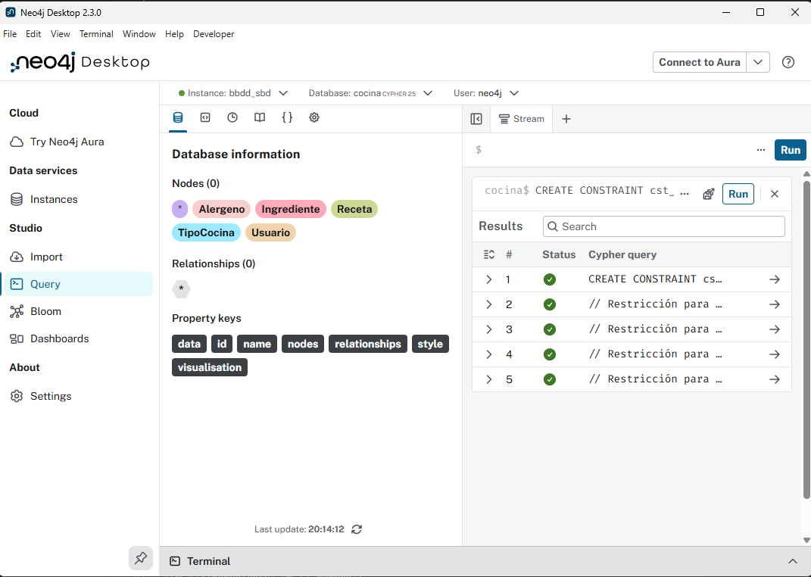

- Creación de índices secundarios (`idx_receta_nombre`, `idx_ingrediente_nombre`, `idx_alergeno_nombre`, `idx_receta_dificultad_tiempo`):

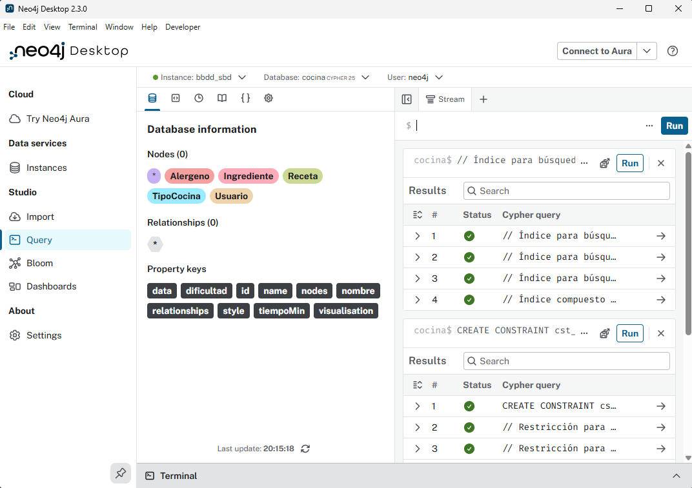

---

## 02 - Inserción de Datos con MERGE (sin duplicados)

Trazas de ejecución del script `02-carga-datos.cypher`:

- Nodos creados: 5 Alérgenos, 4 Tipos de Cocina, 16 Ingredientes, 6 Recetas y 3 Usuarios.
- Relaciones establecidas: `[:TIENE_ALERGENO]`, `[:PERTENECE_A]`, `[:CONTIENE]`, `[:TIENE_INTOLERANCIA]`, `[:TIENE_EN_DESPENSA]` y `[:HA_COCINADO]`.

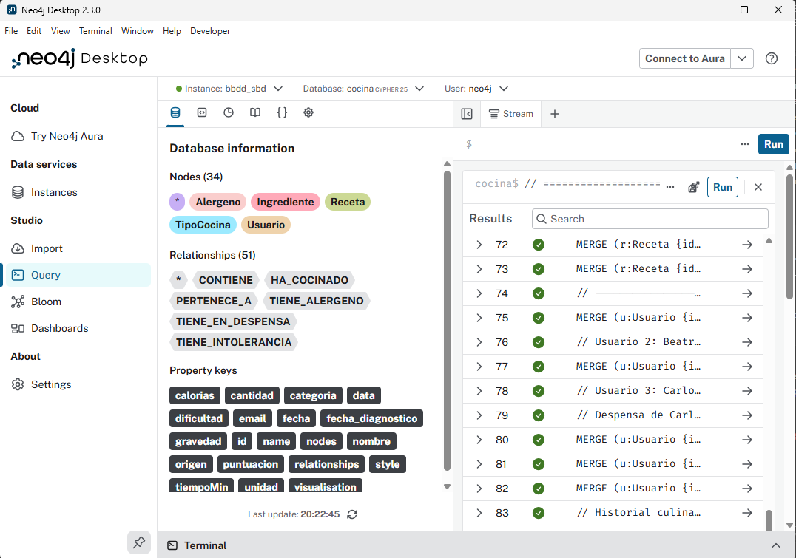

---

## 03 - Visualización General del Grafo Conectado

Grafo resultante visualizado en Neo4j, mostrando la interconexión entre Recetas, Ingredientes, Alérgenos y Usuarios:

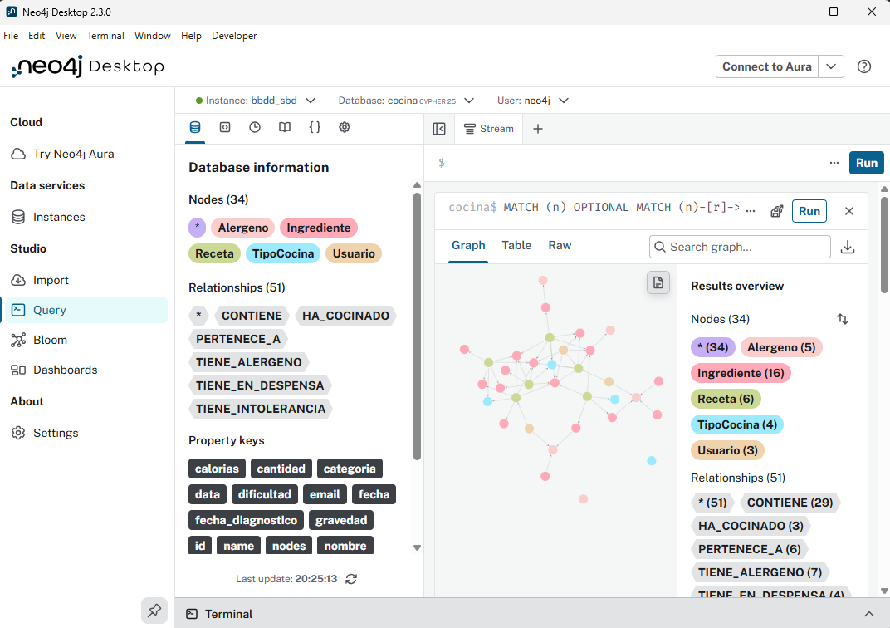

---

## 04 - Consultas de Negocio y Recorridos

### Consulta 1: Vecinos Inmediatos (1 Salto)

Ingredientes y tipo de cocina del plato 'Tortilla de Patatas':
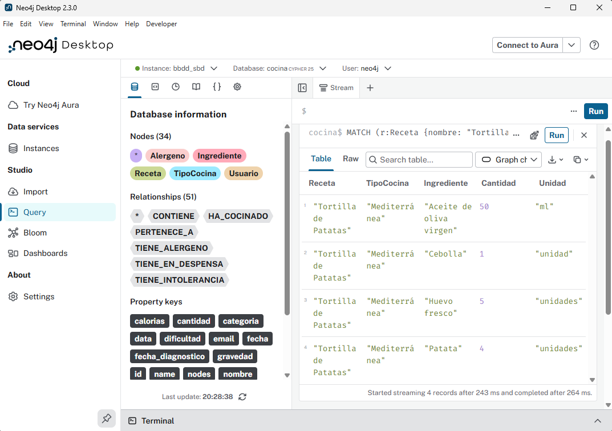

### Consulta 2: Detección de Alérgenos por Plato (Múltiples Saltos)

Recorrido `(Receta)->(Ingrediente)->(Alergeno)`:
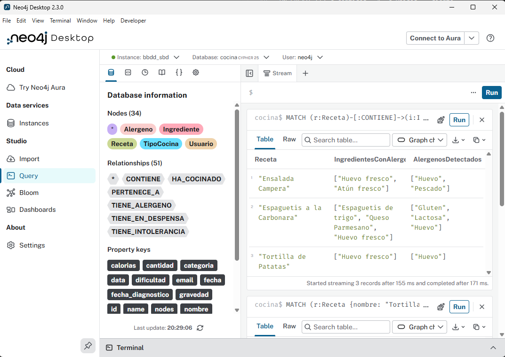

### Consulta 3: Exclusión Estricta de Alérgenos con PROFILE

Exclusión de recetas con Gluten y análisis del plan con `NodeIndexSeek` en el perfilador de Neo4j:
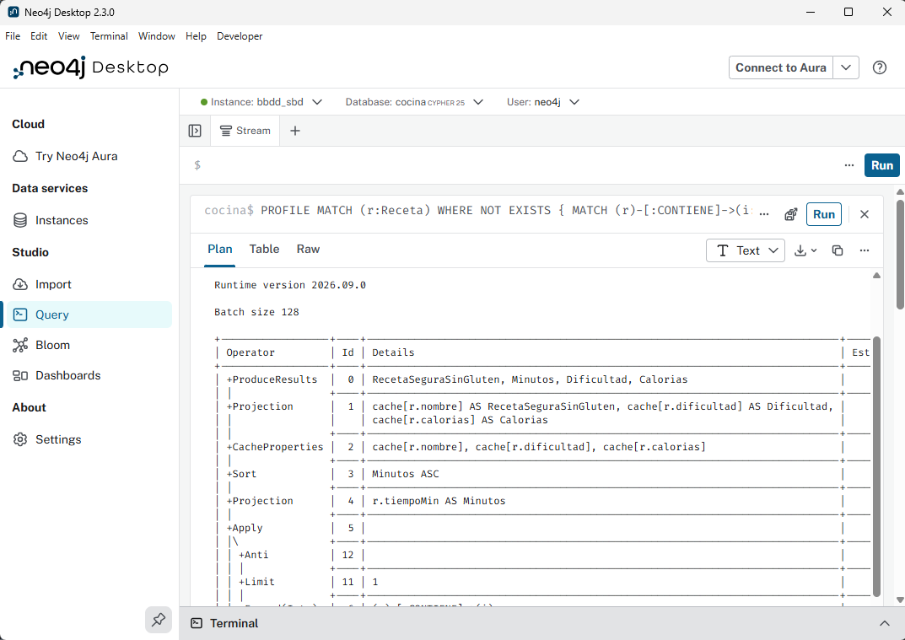

### Consulta 4: Sugerencia de Recetas según Despensa

Recetas factibles a partir de los ingredientes disponibles de Carlos Martínez:
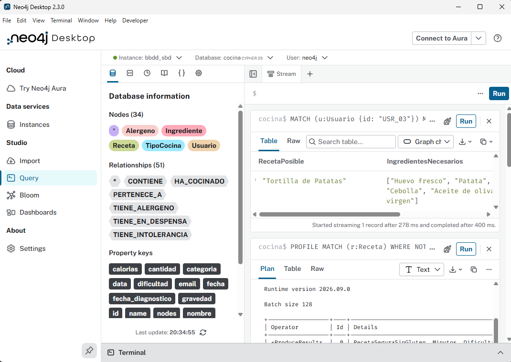

### Consulta 5: Recomendación por Afinidad e Ingredientes Compartidos

Platos con alta coincidencia de ingredientes respecto a la Tortilla de Patatas:
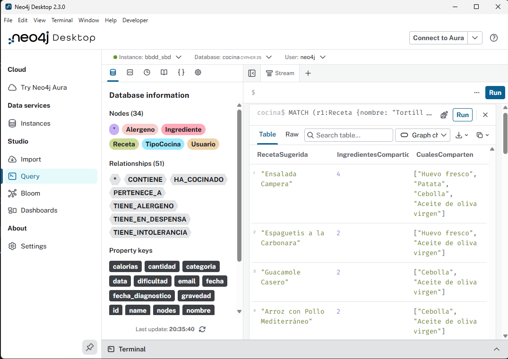

### Consulta 6: Camino Más Corto (shortestPath)

Distancia mínima y conexiones intermedias entre Tortilla de Patatas y Tacos de Pollo Suaves:
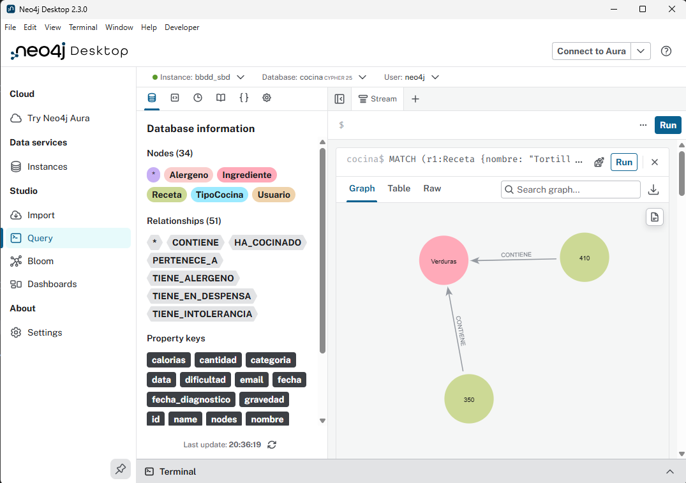

---

## 05 - Gestión de Usuarios, Roles y Permisos

Creación y configuración de usuarios con sus respectivos roles:
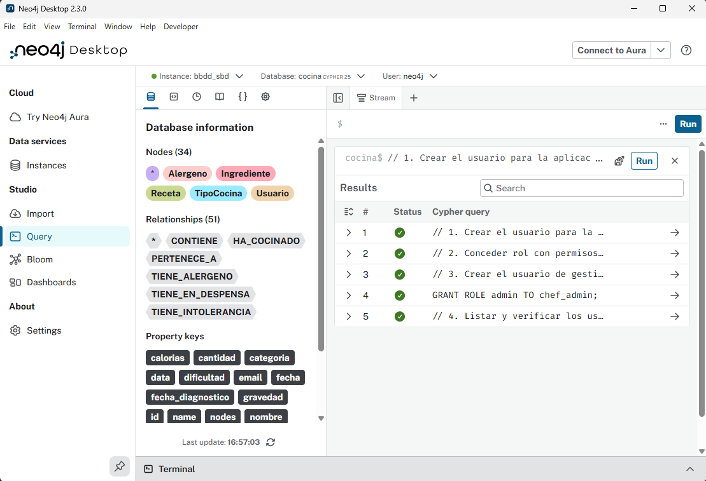

Verificación de usuarios en el entorno mediante `SHOW USERS`:

- **`usuario_reader`**: Rol de solo lectura.
- **`chef_admin`**: Rol de administración.

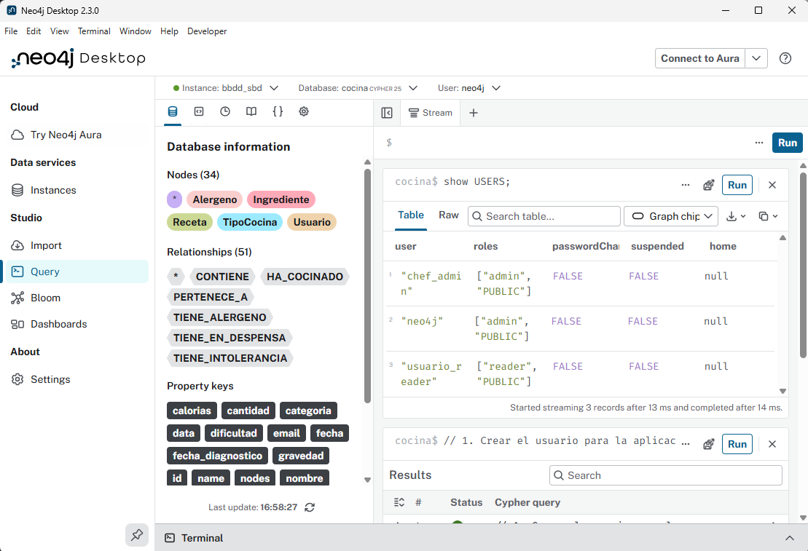
