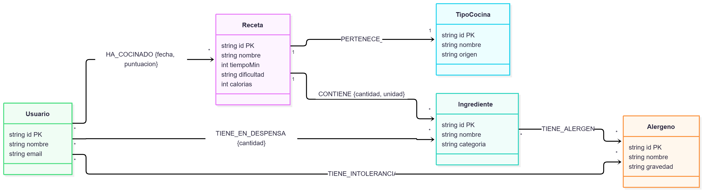

# Modelo del Grafo: Recetas, Ingredientes y Alérgenos

## 1. Diagrama del modelo conceptual

---

## 2. Nodos y propiedades del grafo

1. **`:Receta`**: Representa los platos culinarios disponibles.
   - `id` (String, Obligatorio, Único): Identificador alfanumérico.
   - `nombre` (String, Obligatorio): Nombre descriptivo de la receta.
   - `tiempoMin` (Integer): Tiempo estimado de preparación en minutos.
   - `dificultad` (String): Nivel de complejidad.
   - `calorias` (Integer): Estimación calórica por ración.

2. **`:Ingrediente`**: Representa cada producto alimentario.
   - `id` (String, Obligatorio, Único): Identificador único.
   - `nombre` (String, Obligatorio): Denominación del alimento.
   - `categoria` (String): Familia a la que pertenece.

3. **`:Alergeno`**: Representa las sustancias o alérgenos alimentarios oficiales.
   - `id` (String, Obligatorio, Único): Código identificativo.
   - `nombre` (String, Obligatorio): Nombre del alérgeno.
   - `gravedad` (String): Nivel de severidad o riesgo asociado.

4. **`:TipoCocina`**: Representa los distintos estilos gastronómicos y tradiciones culinarias.
   - `id` (String, Obligatorio, Único): Código identificador.
   - `nombre` (String, Obligatorio): Estilo.
   - `origen` (String): Región geográfica o cultural de procedencia.

5. **`:Usuario`**: Representa a los usuarios que interactúan con la plataforma.
   - `id` (String, Obligatorio, Único): Identificador de cuenta.
   - `nombre` (String, Obligatorio): Nombre o alias del comensal.
   - `email` (String, Obligatorio): Dirección de contacto ficticia.

---

## 3. Relaciones y sus atributos

| Relación                | Nodo origen    | Nodo destino   | Propiedades           | Motivo de diseño                                                                |
| ----------------------- | -------------- | -------------- | --------------------- | ------------------------------------------------------------------------------- |
| `[:CONTIENE]`           | `:Receta`      | `:Ingrediente` | `cantidad`, `unidad`  | Indica los ingredientes que componen un plato y la proporción requerida.        |
| `[:PERTENECE_A]`        | `:Receta`      | `:TipoCocina`  | Ninguna               | Clasifica cada plato dentro de una tradición gastronómica.                      |
| `[:TIENE_ALERGENO]`     | `:Ingrediente` | `:Alergeno`    | Ninguna               | Relaciona los ingredientes con los alérgenos que contienen de forma intrínseca. |
| `[:TIENE_EN_DESPENSA]`  | `:Usuario`     | `:Ingrediente` | `cantidad`            | Registra los productos y la cantidad disponible en la despensa del usuario.     |
| `[:TIENE_INTOLERANCIA]` | `:Usuario`     | `:Alergeno`    | `fecha_diagnostico`   | Señala las restricciones de salud que el usuario debe evitar estrictamente.     |
| `[:HA_COCINADO]`        | `:Usuario`     | `:Receta`      | `fecha`, `puntuacion` | Guarda el historial de platos preparados y la valoración dada por el usuario.   |

---

## 4. Decisiones de diseño: ¿Cuándo usar Nodo y cuándo Propiedad?

- **¿Por qué `Alergeno` es un nodo independiente y no una lista en `Receta` o `Ingrediente`?**  
  Almacenar alérgenos como una simple lista de cadenas de texto (`receta.alergenos = ["gluten", "lactosa"]`) causaría redundancia, dificultaría la trazabilidad y haría lentas las búsquedas cruzadas. Al crear un nodo propio conectado a `Ingrediente`:
  1. Se simplifican las exclusiones directas en grafos mediante patrones: `NOT (receta)-[:CONTIENE]->()-[:TIENE_ALERGENO]->(:Alergeno {nombre: 'Gluten'})`.
  2. Si la clasificación de un alérgeno cambia, se actualiza en un único nodo sin alterar miles de registros.
  3. Las recetas heredan automáticamente los alérgenos de sus ingredientes, evitando errores manuales al catalogar nuevos platos.

- **¿Por qué considerar `TipoCocina` como entidad/nodo?**  
  Tratarlo como nodo permite agrupar y explorar recetas afines de manera nativa mediante saltos en el grafo, además de facilitar recomendaciones entre comensales y cocineros con gustos compartidos.

- **Atributos dentro de la relación `[:CONTIENE]`:**  
  Tanto la cantidad como la unidad de medida no definen a la receta por sí sola ni al ingrediente por separado; cobran sentido únicamente en el contexto de esa receta concreta. Por eso se guardan directamente dentro de la propia relación que los une.

---

## 5. Estrategia de claves y tipos de datos

- **Identificadores propios con prefijos:** Se han definido códigos claros según el tipo de elemento respaldados por restricciones de unicidad. Esto evita depender de los identificadores internos autogenerados por Neo4j y asegura que podamos cargar los datos repetidas veces con `MERGE` sin que se dupliquen registros.
- **Tipos de datos empleados:**
  - **Texto (`String`):** Nombres, descripciones, correos electrónicos y categorías.
  - **Enteros (`Integer`):** Tiempos de cocinado, recuento calórico, raciones y valoraciones.
  - **Fechas temporales (`Date`):** Funciones nativas `date('YYYY-MM-DD')` para registrar cuándo se cocinó un plato o la fecha de diagnóstico de una intolerancia.

---

## 6. Consideraciones de escalabilidad y prevención de supernodos

- **Control de supernodos:**  
  En un grafo gastronómico, condimentos universales como la **sal**, el **agua** o el **aceite de oliva** acabarían vinculados a casi cualquier receta, acumulando miles de conexiones. Expandir estos nodos durante algoritmos de caminos o similitud penalizaría el rendimiento en memoria y CPU.
  - _Medida adoptada:_ Se excluyen estos ingredientes básicos y libres de alérgenos de los algoritmos de afinidad o se identifican con etiquetas auxiliares para no recorrerlos innecesariamente.
- **Buenas prácticas de consulta:**
  1. Se evitan escaneos completos del grafo, asegurando que las consultas arranquen desde búsquedas apoyadas en índices.
  2. Las agregaciones analíticas globales pesadas se minimizan dentro del motor, manteniéndolo centrado en recorridos y patrones locales.
